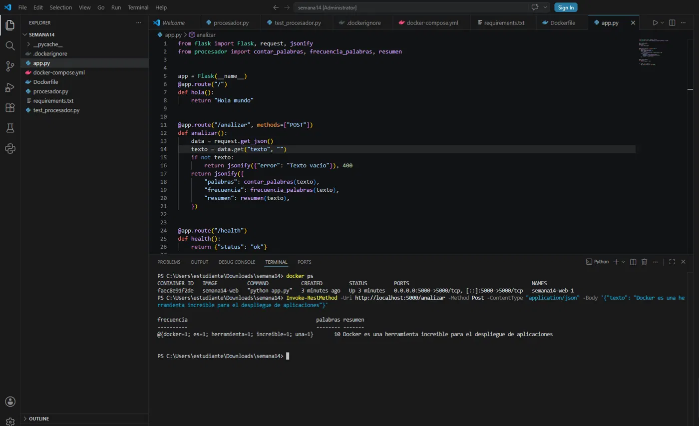

# Procesador de Texto con Docker

API Flask que analiza texto cuenta palabras, calcula la frecuencia de
palabras y genera un resumen, containerizada con Docker y orquestada
con Docker Compose.

## Arquitectura

- `procesador.py`: lógica de procesamiento de texto
- `app.py`: API Flask con los endpoints `/`, `/health` y `/analizar`
- `test_procesador.py`: tests unitarios (se ejecutan durante el build)
- `requirements.txt`: dependencias (Flask)
- `Dockerfile`: imagen basada en `python:3.11-slim`, con cache de capas
  y tests en el build
- `.dockerignore`: excluye archivos innecesarios del build
- `docker-compose.yml`: define el servicio `web` en el puerto 5000

## Construir y ejecutar

```bash
docker compose up -d --build
```

## Probar

```bash
curl http://localhost:5000/
curl http://localhost:5000/health
curl -X POST http://localhost:5000/analizar -H "Content-Type: application/json" -d '{"texto": "Docker es una herramienta increible"}'
```

En PowerShell:

```powershell
Invoke-RestMethod -Uri http://localhost:5000/analizar -Method Post -ContentType "application/json" -Body '{"texto": "Docker es una herramienta increible"}'
```

## Ejecutar los tests

Los tests se ejecutan automáticamente al construir la imagen. También
se pueden correr localmente:

```bash
python -m unittest test_procesador -v
```

## Detener

```bash
docker compose down        
```

## Captura de funcionamiento

